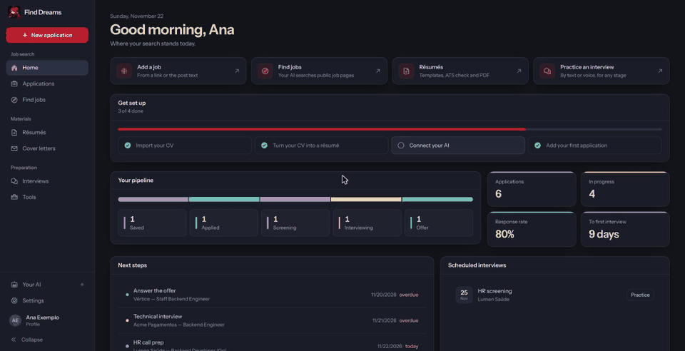
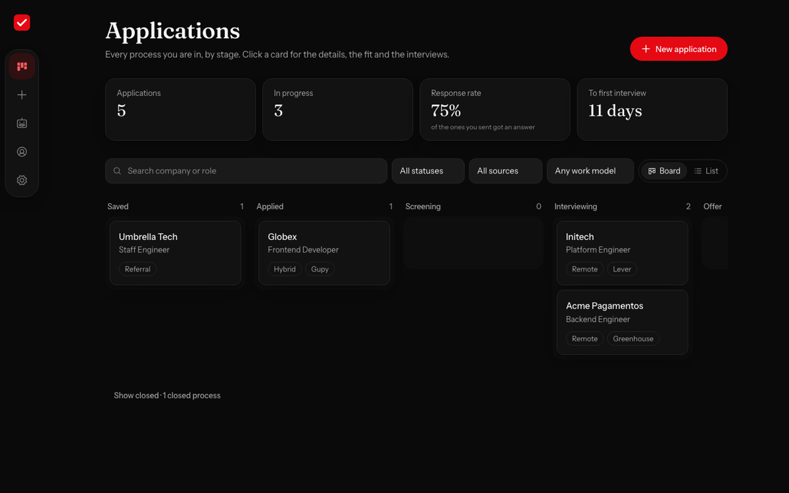
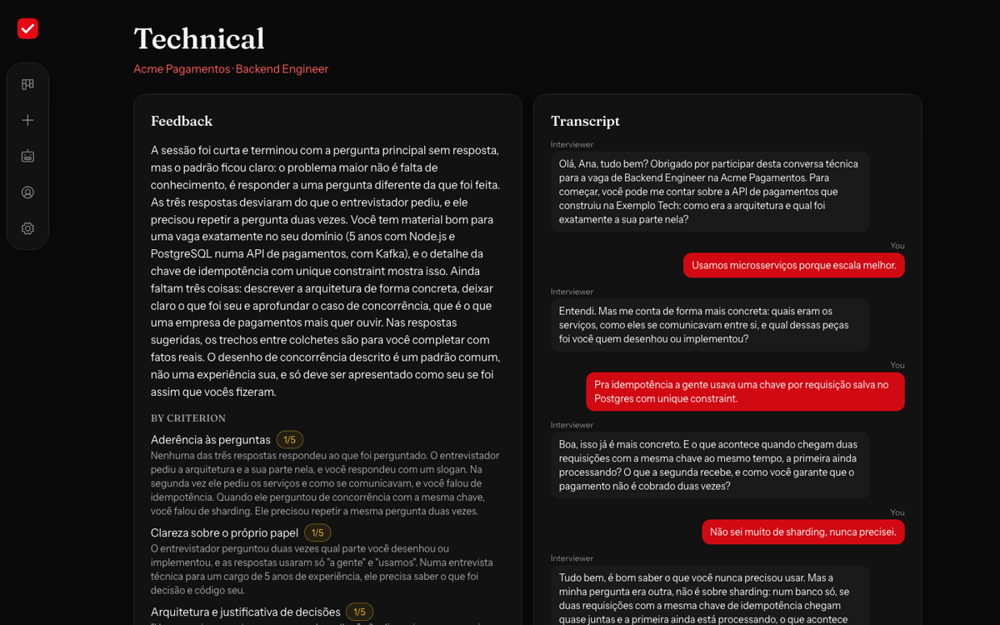
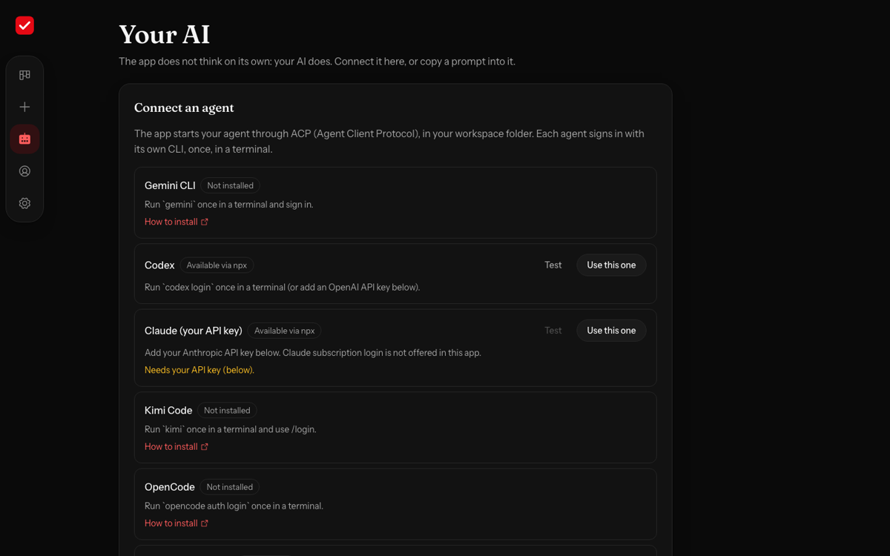

<p align="center"></p>

# MZN Vagas

**Your job search, on your machine.** Track every application, see how you fit each job and rehearse every interview
stage — HR, technical, client, hiring manager, live coding, system design — by text or voice, with **your own AI**
(Claude, Codex, Gemini CLI, Kimi, OpenCode, Copilot… or a local model on Ollama).

<p align="center">
  <a href="https://github.com/pedromzn/mzn-vagas/releases/latest"><b>⬇ macOS (.dmg)</b></a> ·
  <a href="https://github.com/pedromzn/mzn-vagas/releases/latest"><b>⬇ Windows (.exe)</b></a> ·
  <a href="https://github.com/pedromzn/mzn-vagas/releases/latest"><b>⬇ Linux (.AppImage / .deb)</b></a>
</p>



- **No account, no server of ours**: your CV, salary and recruiter messages stay on your computer.
- **The app calls no AI on its own**: the intelligence is the AI you already use, connected through
  [ACP](https://agentclientprotocol.com) — or you paste a one-line prompt into it.
- **English and Brazilian Portuguese**, for the app and for the interviews.

## What it does

- **Applications board** — kanban or list by stage, salary, work model, pros and cons, next steps with dates, contacts
  (name and role only), and the numbers that matter: response rate, days to the first interview. Add a job from a link
  (Greenhouse, Lever, Gupy, Ashby, most career pages; LinkedIn needs a pasted text) or pasted text.
- **A copilot per job** — your AI analyzes the fit (what matches, what is missing and how to address it, what to say to
  impress — never inventing experience), researches the company from public sources, and drafts 2–3 replies to
  recruiter messages. Nothing is ever sent for you.
- **Practice interviews** — an interviewer built from the job, the company and what earlier stages taught you, for
  each stage: HR screening, technical, client (consultancies and outsourcing), hiring manager, live coding, system
  design, take-home review, panel, language, final round, case study, async video. By text or by voice (Whisper and
  Kokoro, running locally). Then feedback that quotes where you got stuck and gives you a better answer.
- **Debriefs** of real interviews, so the next stage is prepared with what you actually heard.
- **Résumés and cover letters** — your CV becomes a structured résumé in three templates (Modern, Harvard, Classic),
  tailored to each job and translated by your AI without inventing anything, with an **instant ATS check** (the post's
  keywords your résumé has and lacks) and PDF export. Cover letters in the tone you choose, editable in place.
- **Find jobs and tools** — your AI searches public job pages (never LinkedIn) for jobs that fit you; follow-up e-mails,
  salary research with sources, and an apply kit per job. The app never applies for you.

| The board                             | An application                              |
| ------------------------------------- | ------------------------------------------- |
|        |  |
| **Feedback of a practice interview**  | **Your AI**                                 |
|  |            |

## Install

Download the installer for your system from the [latest release](https://github.com/pedromzn/mzn-vagas/releases/latest).
The builds are **not code-signed yet**, so the system warns you the first time:

- **macOS**: right-click the app in Applications → **Open** → **Open** (or System Settings → Privacy & Security →
  "Open Anyway"). Unsigned macOS apps cannot update themselves: the app tells you when a new version is out.
- **Windows**: SmartScreen → **More info** → **Run anyway**. Updates install by themselves.
- **Linux (AppImage)**: `chmod +x MZN-Vagas-*.AppImage`. Updates install by themselves.

## First steps

1. Pick your language, check where your data will live (`Documents/MZN Vagas`), import your CV (PDF or DOCX — you
   review the text) and fill your profile.
2. Add an application from a job link.
3. Open **Your AI**: choose an installed agent and press **Test** (each agent signs in once with its own CLI — see
   [docs/AGENTS-SUPPORT.md](docs/AGENTS-SUPPORT.md)). No agent? Every task also gives you a prompt to paste into any AI
   opened in your data folder.
4. On the application, **Analyze the fit**, then **Interviews → Practice an interview**. For the fastest voice
   conversations, install [Ollama](https://ollama.com) with a model like `qwen3:8b`.

## Privacy

Your data is plain files in your folder; API keys go to the system keychain; the local API is locked to the app's own
window. What goes to the AI you connect is what each task needs. Full details: [docs/PRIVACY.md](docs/PRIVACY.md) and
[SECURITY.md](SECURITY.md).

## Run from source

```bash
git clone https://github.com/pedromzn/mzn-vagas.git
cd mzn-vagas
npm install
npm run dev            # in the browser, http://localhost:3060 (data in ./workspace)
npm run desktop:dev    # the Electron app
npm run desktop:build  # an installer for this system, in release/
```

Node 24 LTS (22.13 or newer).

## Contributing

See [CONTRIBUTING.md](CONTRIBUTING.md) — including how to add an interview type, an agent or an eval — and
[AGENTS.md](AGENTS.md). How it is built and why: [docs/ARCHITECTURE.md](docs/ARCHITECTURE.md). The plan:
[docs/PLAN.md](docs/PLAN.md).

## License

[MIT](LICENSE)
