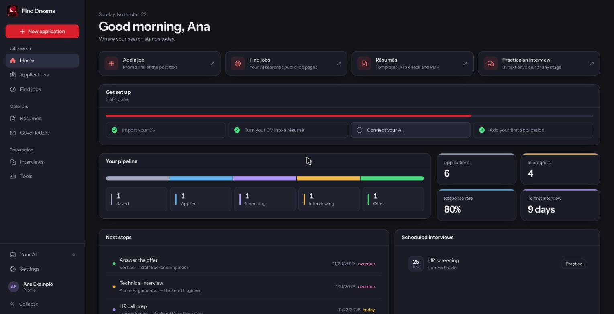
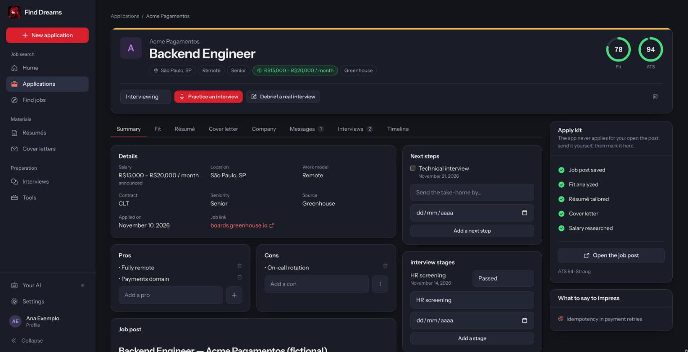
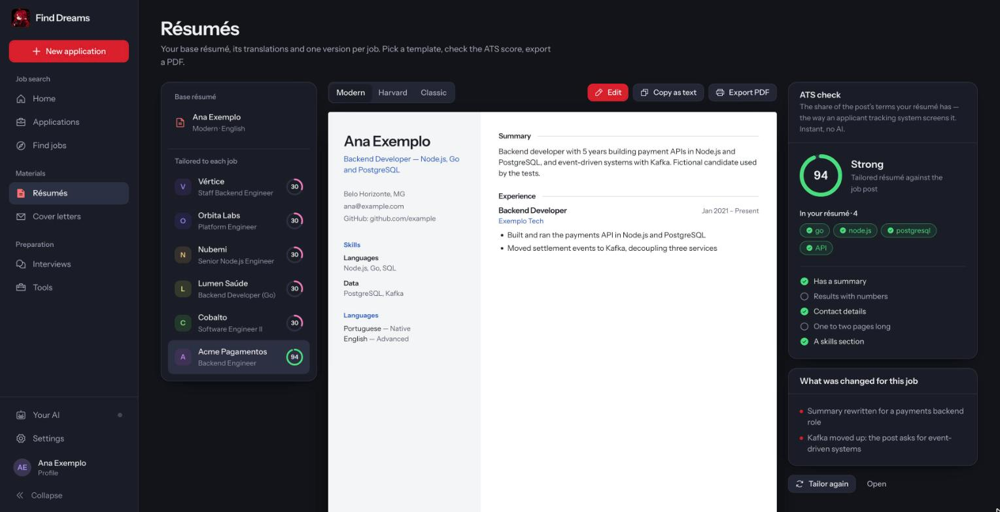

<p align="center"></p>

# Find Dreams

[](https://github.com/pedromzn/Find_Dreams/actions/workflows/ci.yml)
[](https://github.com/pedromzn/Find_Dreams/actions/workflows/codeql.yml)
[](LICENSE)

**Your job search, on your machine.** Track every application, see how you fit each job, tailor your résumé and cover
letter, and rehearse every interview stage — HR, technical, client, hiring manager, live coding, system design — by text
or voice, with **your own AI** (Claude, Codex, Gemini CLI, Kimi, OpenCode, Copilot… or a local model on Ollama).

<p align="center">
  <a href="https://github.com/pedromzn/Find_Dreams/releases/latest"><b>⬇ macOS (.dmg)</b></a> ·
  <a href="https://github.com/pedromzn/Find_Dreams/releases/latest"><b>⬇ Windows (.exe)</b></a> ·
  <a href="https://github.com/pedromzn/Find_Dreams/releases/latest"><b>⬇ Linux (.AppImage / .deb)</b></a>
</p>


- **No account, no server of ours**: your CV, salary and recruiter messages stay on your computer.
- **The app calls no AI on its own**: the intelligence is the AI you already use, connected through
  [ACP](https://agentclientprotocol.com) — or you paste a one-line prompt into it.
- **English and Brazilian Portuguese**, for the app and for the interviews. Dark and light themes.

## What it does

- **Home** — your pipeline by stage, the numbers that matter (response rate, days to the first interview), what is due
  this week, the interviews on the calendar and what is ready for each application.
- **Applications board** — kanban or list by stage, with fit score, next step and due date on each card; salary, work
  model, pros and cons, contacts (name and role only). Add a job from a link (Greenhouse, Lever, Gupy, Ashby, most
  career pages) or by pasting the whole page — for LinkedIn, ⌘A ⌘C on the post and paste: the app finds the role,
  company, place, pay and the post itself, locally.
- **A copilot per job** — your AI analyzes the fit (what matches, what is missing and how to address it, what to say to
  impress — never inventing experience), researches the company from public sources, drafts 2–3 replies to recruiter
  messages and follow-ups, and researches the salary with sources. An **apply kit** shows what is ready to send. Nothing
  is ever sent or applied for you.
- **Résumés** — your CV becomes a structured résumé in three templates (Modern, Harvard, Classic), tailored to each job
  and translated by your AI without inventing anything. An **instant ATS check** shows the post's keywords your résumé
  has and lacks. Edit any line by hand with a live preview; export a PDF.
- **Cover letters** — one per job, in the tone you choose, editable in place, reviewed by your AI on request.
- **Find jobs** — your AI searches public job pages (company career sites, Greenhouse, Lever, Gupy — never LinkedIn) for
  jobs that fit your profile; you triage the list and save the ones you want.
- **Practice interviews** — an interviewer built from the job, the company and what earlier stages taught you, for each
  stage: HR screening, technical, client (consultancies and outsourcing), hiring manager, live coding, system design,
  take-home review, panel, language, final round, case study, async video. By text or by voice (Whisper and Kokoro,
  running locally). Then feedback that quotes where you got stuck and gives you a better answer.
- **Debriefs** of real interviews, so the next stage is prepared with what you actually heard.

| Home                                        | The board                           |
| ------------------------------------------- | ----------------------------------- |
|                |      |
| **An application**                          | **Résumé studio and ATS check**     |
|  |  |

## Requirements

- **To use the app**: macOS, Windows or Linux, and one AI agent installed and signed in with its own CLI (see
  [docs/AGENTS-SUPPORT.md](docs/AGENTS-SUPPORT.md)) — or any AI you can paste a prompt into.
- **Optional**: [Ollama](https://ollama.com) with a model like `qwen3:8b` for the fastest voice interviews; Python 3.10–3.13
  (or [uv](https://docs.astral.sh/uv/)) for the local voice, installed on demand (~1 GB, in the app's data folder).
- **To run from source**: Node 24 LTS (22.13 or newer) and npm.

## Install

Download the installer for your system from the [latest release](https://github.com/pedromzn/Find_Dreams/releases/latest).
The builds are **not code-signed yet**, so the system warns you the first time:

- **macOS**: right-click the app in Applications → **Open** → **Open** (or System Settings → Privacy & Security →
  "Open Anyway"). Unsigned macOS apps cannot update themselves: the app tells you when a new version is out.
- **Windows**: SmartScreen → **More info** → **Run anyway**. Updates install by themselves.
- **Linux (AppImage)**: `chmod +x Find-Dreams-*.AppImage`. Updates install by themselves.

## First steps

1. Pick your language, check where your data will live (`Documents/Find Dreams`), import your CV (PDF or DOCX — you
   review the text) and fill your profile.
2. Open **Your AI**: choose an installed agent and press **Test** (each agent signs in once with its own CLI). No agent?
   Every task also gives you a prompt to paste into any AI opened in your data folder.
3. **Résumés → Build my résumé with my AI**: your CV becomes a structured résumé you can render, edit and export.
4. Add an application from a job link or a pasted page, then **Analyze the fit**, tailor the résumé, write the cover
   letter and **Practice an interview**.

## Run from source

```bash
git clone https://github.com/pedromzn/Find_Dreams.git
cd Find_Dreams
npm install
npm run dev            # in the browser, http://localhost:3060 (data in ./workspace)
npm run desktop:dev    # the Electron app
npm run desktop:build  # an installer for this system, in release/
```

## Commands

| Command                                                     | Does                                                                   |
| ----------------------------------------------------------- | ---------------------------------------------------------------------- |
| `npm run dev`                                               | the server and the app at http://localhost:3060 (data in `workspace/`) |
| `npm start`                                                 | build and local production server                                      |
| `npm run desktop:dev` / `desktop:build`                     | the Electron app / an installer for this system, in `release/`         |
| `npm run verify`                                            | everything CI checks: format, types, tests, validation, evals, build   |
| `npm test`                                                  | Vitest                                                                 |
| `npm run vagas:status` / `vagas:validate` / `vagas:schemas` | the workspace files, their validation, the JSON Schemas in `docs/`     |
| `npm run evals [-- --live --brain ollama\|acp\|api]`        | product evals: recorded (CI) or against a real brain                   |
| `npm run voice:install` / `voice:test`                      | the local voice (Whisper + Kokoro) in the app's data folder            |
| `npm run privacy:check`                                     | fails if git tracks anything that may hold personal data               |
| `npm run format`                                            | Prettier                                                               |

## Folder structure

```
Find_Dreams/
├── AGENTS.md            the manual for whoever develops the app (CLAUDE.md and the Cursor rule point to it)
├── .claude/skills/      development skills: add-interview-type, add-agent, write-eval
├── agent-kit/           what is copied into the person's workspace: their AI's manual and skills
├── shared/              zod contracts (every workspace file), the API contract, the ATS check, the paste reader
├── server/              Express: API, workspace store, SQLite index, ACP client, interview brains, voice
├── web/                 React 19 + Tailwind 4, i18n in en and pt-BR
├── desktop/             Electron main, preload, keychain, updater
├── voice/               the local Python processes: Whisper (ear) and Kokoro (voice)
├── evals/               recorded cases of how the AI behaves, checked in CI
├── scripts/             vagas:*, voice:*, evals, privacy check, desktop build
├── test/fixtures/       a fictional candidate's workspace, used by the tests
└── docs/                plan, architecture, privacy, agent support, generated JSON Schemas
```

Your data lives outside the repository, in the workspace folder (`~/Documents/Find Dreams` in the desktop app,
`./workspace` in development): plain JSON and Markdown files your AI reads and writes.

## Privacy

- **Nothing leaves your machine on its own.** The local API listens only on `127.0.0.1`, locked to the app's own window,
  and the app sends no telemetry.
- Your data is plain files in your workspace; API keys go to the operating system keychain.
- The app calls no AI. What reaches the internet is **your AI**, when a task needs it (researching a company, a salary
  range, public job pages), under the rules of the tool you use — never with your CV or name in a search.
- Job links are read from public pages only; LinkedIn is never scraped — you paste the page yourself.
- Full details: [docs/PRIVACY.md](docs/PRIVACY.md) and [SECURITY.md](SECURITY.md).

## Contributing

See [CONTRIBUTING.md](CONTRIBUTING.md) — including how to add an interview type, an agent or an eval — and
[AGENTS.md](AGENTS.md). Run `npm run verify` before the pull request. How it is built and why:
[docs/ARCHITECTURE.md](docs/ARCHITECTURE.md). The plans: [docs/PLAN.md](docs/PLAN.md) and
[docs/PLAN-V2.md](docs/PLAN-V2.md). Security problems: [SECURITY.md](SECURITY.md). Everyone follows the
[code of conduct](CODE_OF_CONDUCT.md).

## License

[MIT](LICENSE)

---

## Em português

O **Find Dreams** organiza a sua busca de emprego no seu computador, com **a sua própria IA** (Claude, Codex, Gemini
CLI, Kimi, OpenCode, Copilot ou um modelo local no Ollama). Sem conta e sem servidor nosso: o CV, o salário e as
mensagens de recrutadores ficam na sua máquina.

- **Candidaturas** num quadro por etapa, com fit, próximo passo e prazo. Adicione pelo link da vaga ou colando a página
  inteira — no LinkedIn, ⌘A ⌘C na vaga e cole: o app separa cargo, empresa, local, salário e o texto, sem internet.
- **Currículos** em três modelos (Moderno, Harvard, Clássico), adaptados a cada vaga e traduzidos pela sua IA sem
  inventar nada, com **checagem ATS na hora**, edição à mão com pré-visualização e PDF.
- **Cartas de apresentação**, **follow-ups**, **pesquisa salarial** com fontes e um **kit de candidatura** por vaga. O
  app nunca envia nada nem se candidata por você.
- **Buscar vagas**: a sua IA procura em páginas públicas de vagas (nunca no LinkedIn) e você escolhe o que salvar.
- **Simulações de entrevista** de todas as etapas — RH, técnica, cliente, gestor, live coding, system design e mais —
  por texto ou voz (Whisper e Kokoro, locais), com feedback que cita onde você travou e uma resposta melhor.

Baixe o instalador na [última versão](https://github.com/pedromzn/Find_Dreams/releases/latest), ou rode do código-fonte
com `npm install` e `npm run desktop:dev` (Node 24). Os dados ficam em `~/Documents/Find Dreams`.
